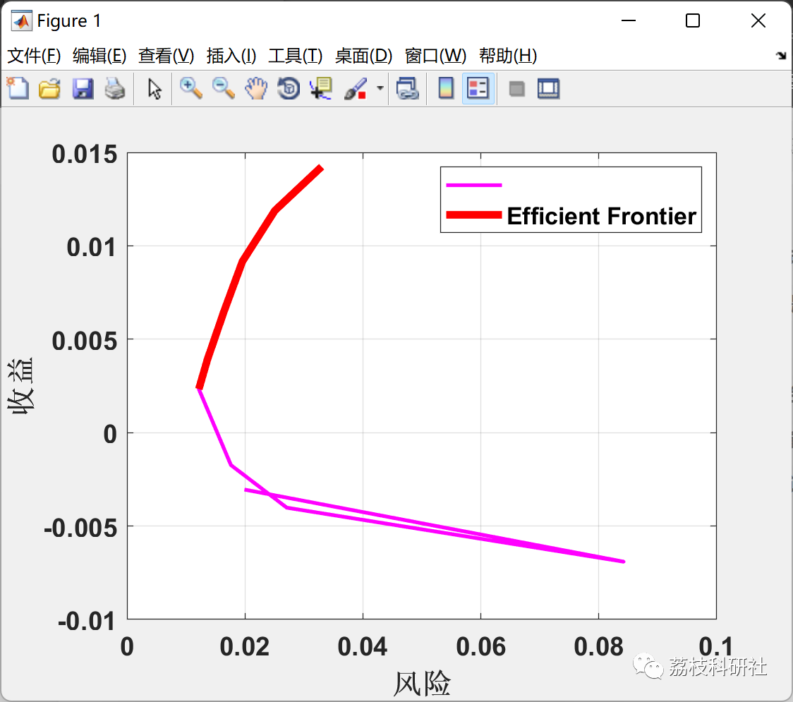
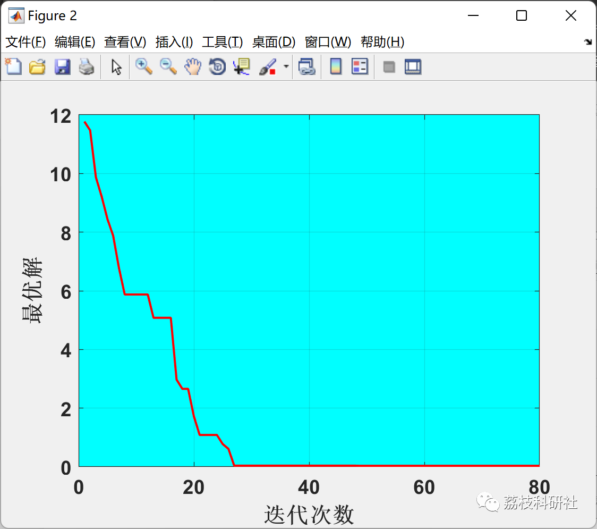

# Portfolio Optimization Problem Based on Bee Optimization Algorithm (Matlab Code Implementation)

💥💥💥💞💞💞 Welcome to this blog❤️❤️❤️ 💥💥💥
🏆 Bloggers' Advantages: 🌞🌞🌞 The content of the blog strives for rigorous thinking and clear logic, making it convenient for readers.
⛳️ Mantra: A journey of a thousand miles is begun with a single step.
Litchi Research Society
Code Collection: Electric power systems, intelligent algorithms and applications, neural network prediction, path planning, optimization dispatching, workshop scheduling, image processing, signal processing...
🎁 Special Section Links:
🌈🌈🌈🌟🌟🌟 Electrical Code Drone and Physical Application Path Planning Intelligent Algorithms and Their Applications Optimized Dispatching Neural Network Prediction Workshop Scheduling Image Processing Romantic Her Signal Processing Mathematical Modelling My Thoughts Speech Processing Complete Code Issues
💥1 Overview
📚2 Run Results
🎉3 MATLAB Code Realization
​
💥1 Overview
Portfolio selection is an important issue in the financial field, essentially about optimal wealth allocation among available assets. With the development of financial markets and the enhancement of people's investment awareness, research on portfolio selection has received increasing attention.
Bee Optimization Algorithm is a new emergent population-based algorithm, yet it has not been applied to portfolio selection problems. The algorithm is simple in principle and powerful in development, but lacks mutation mechanisms, resulting in weaker exploration capabilities. To balance the algorithm's exploration and development capabilities, enhance its solving performance on portfolio selection problems, this paper designs a Bee Optimization Algorithm with superior performance for different portfolio models.
📚2 Run Results
🎉3 MATLAB Code Realization
Click the article's lower left corner to [Read Full Content]

## Images

<!-- PAYMENT_BLOCK -->

## Get this dataset

- Payment link (Stripe): [Buy now](https://buy.stripe.com/3cs8yP7sY87d0vu9AB)
- Payment QR code: 

<!-- /PAYMENT_BLOCK -->
